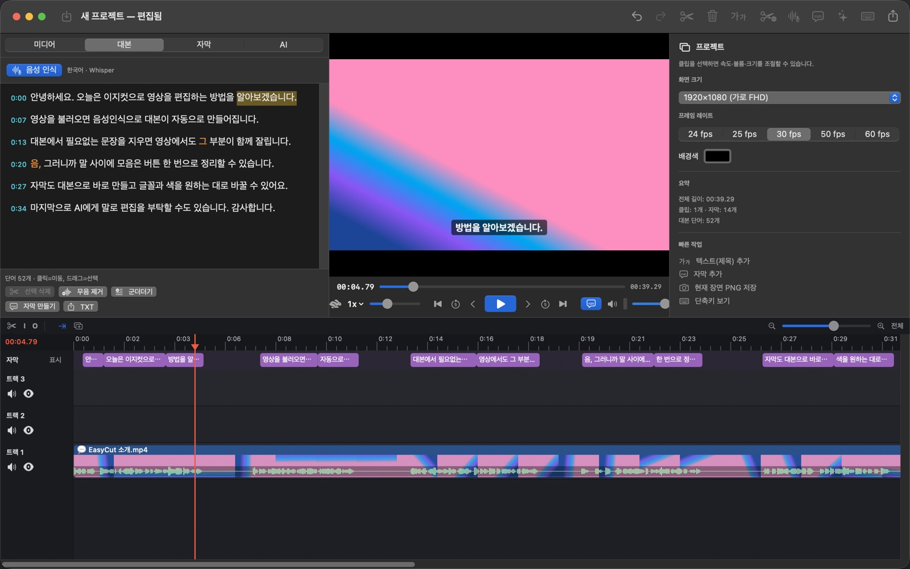
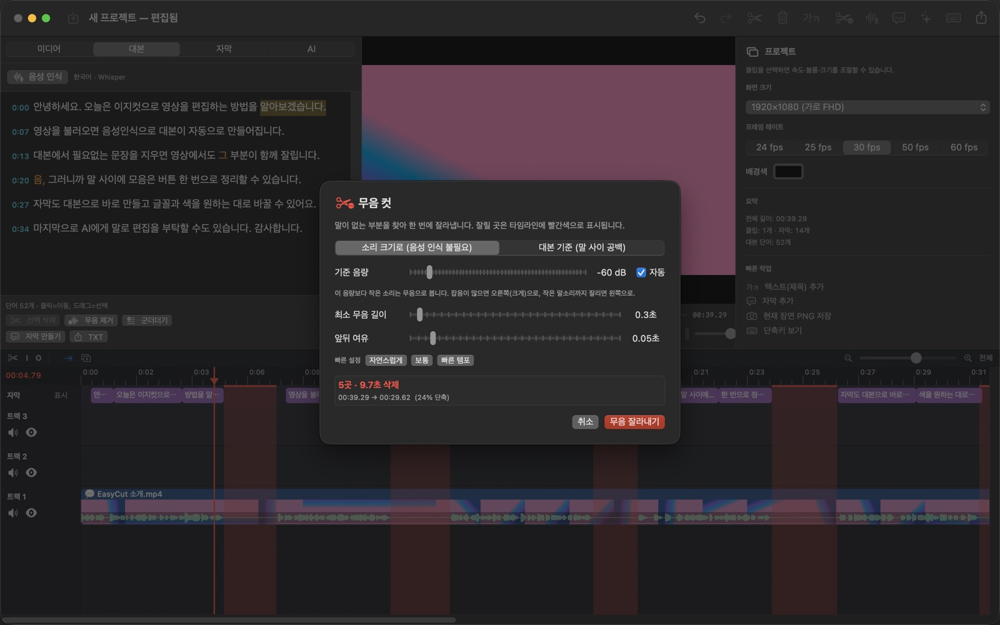
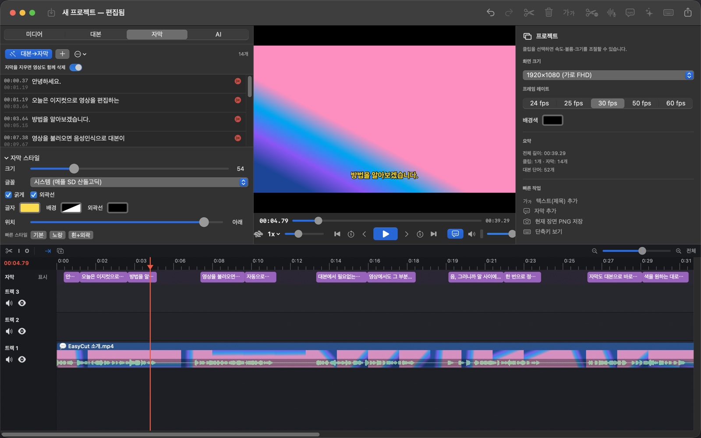
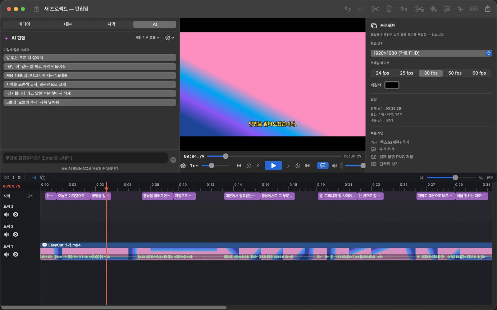

# EasyCut — an easy video editor

[한국어](README.md) | **English**

EasyCut is a Mac and Windows video editor that puts simple cut editing, transcript-based editing with speech recognition (STT), captions, screen & face recording and AI editing in one app. From macOS 1.13.0 and Windows 0.7.0, describe an animation, explainer or promo video, review its sample frames, then render it and continue editing on the timeline.

**[⬇︎ Download the latest version (Releases)](https://github.com/contenjoo/easycut/releases/latest)** · [Website](https://contenjoo.github.io/easycut/)

Windows: [download EasyCut for Windows](https://github.com/contenjoo/easycut/releases/download/win-v0.7.0/EasyCut_0.7.0_x64-setup.exe) · [announcement](docs/announcements/windows-beta.en.md) · source in [`windows/`](windows)

Made by [Learn Today (주식회사 오늘배움)](https://learntoday.kr/services), which also builds Joo.is and JooShow.

https://github.com/user-attachments/assets/7ccb22e8-b7db-4925-839e-431f966ce512



| One-click silence cut | Caption styles | AI editing |
|---|---|---|
|  |  |  |

The Mac app follows your macOS language: English on English (and any non-Korean) systems, Korean on Korean systems. You can switch it in **EasyCut › Language** (applies after a restart).

## Install

### Mac

Requires an **Apple Silicon Mac (M1 or later) with macOS 14 or later**.

1. Download `EasyCut-x.y.z.dmg` from [Releases](https://github.com/contenjoo/easycut/releases/latest), open it and drag EasyCut into the Applications folder.
2. The first time only: the app is not notarized, so if macOS warns you, go to System Settings › Privacy & Security and click **Open Anyway**.
3. Download the Whisper model (574 MB) with **Turn On Whisper** in the Transcript tab, and the YouTube tool (yt-dlp) with **Install YouTube Tool** in the link window — once each.

The Whisper speech engine and ffmpeg (for MKV etc.) are bundled for standard editing, with no Homebrew needed. Creating new videos additionally requires Node.js LTS, npm and Google Chrome.
AI editing is optional. Click **Log in with Claude** or **Log in with ChatGPT** in the AI tab and the app installs what it needs and logs you in (uses your subscription, no API key). Your own Claude API key also works; it is stored only in the macOS Keychain.

Updates are automatic from 1.3.0 on: when a new version is released, the app tells you at launch and installs it with one click (**EasyCut › Check for Updates…**).

### Windows

Run [EasyCut_0.7.0_x64-setup.exe](https://github.com/contenjoo/easycut/releases/download/win-v0.7.0/EasyCut_0.7.0_x64-setup.exe) on **Windows 10/11 64-bit**. Start a new video from **Create a Video** in the toolbar. Prepare Node.js LTS, npm and Chrome or Edge for video creation. Rendering packages are installed in the app's support folder on first use.

## Build from source

Needs Xcode Command Line Tools (Swift 5.10+), `cmake` (`brew install cmake`) and `git`.

```bash
./scripts/build_deps.sh      # build Whisper and ffmpeg from source into vendor/bin (once, ~10 minutes)
./scripts/build_app.sh --dmg # zipped app + DMG (dist/)
```

## Features

| Feature | Details |
|---|---|
| Screen & face recording | Record the full screen, a window or a dragged area together with your camera (face), microphone and computer audio. When you stop, the screen goes on Track 1, your face as a small round picture bottom-right on Track 2, computer audio on Track 3, and your voice is transcribed right away. Pause ⌥⌘P, stop ⌥⌘. (work while other apps are in front). Mouse clicks are highlighted. Open with ⌥⌘R; files go to Movies › EasyCut 녹화 |
| Import | Video (MP4 · MOV · M4V, **MKV · WebM · AVI · FLV · WMV · TS · MTS · MPG** …), audio (MP3 · WAV · M4A · AAC · AIFF), photos (PNG · JPG · HEIC · GIF · TIFF). Drag and drop supported |
| Multi-track timeline | Move, trim, split, duplicate, copy/paste clips; mute/hide tracks; snapping; thumbnails and waveforms; adjustable track height; resizable timeline area; groups (⌘G) and join (⌘J) |
| Up to 20× speed | Preview playback 0.25–20×, clip speed 0.1–20× (pitch preserved) |
| Level meter | Shows the loudness of what is playing (if the bar moves but you hear nothing, check your Mac's output device) |
| Speech recognition (STT) | Apple on-device (no install, works offline) or Whisper (optional, high accuracy) |
| Edit by transcript | Select words in the transcript and press ⌫ to cut them from the video. Click a word to jump there, ↩ to fix a word |
| One-click silence cut | Detects silence by loudness (no transcription needed) → red preview on the timeline → delete it all at once |
| Filler removal | Finds filler words such as "um"/"uh" in the transcript and deletes them at once |
| Captions | Generate from the transcript, add/edit by hand, drag on the timeline, style (font, color, background, outline, position), SRT import/export, burn into the video |
| Text (titles) | Text clips on top of the picture with position, size and color |
| Layout & effects | Size, position, opacity, picture-in-picture, fades, shape (circle, rounded rectangle), person background blur/removal |
| Cut by captions | Deleting a caption line also deletes its video; dragging captions in the list reorders the video with them; Track 1 clips can be dragged to insert-reorder (⌥+drag = free move) |
| AI editing | Edit by talking: "cut all the silences", "2× speed from 3:00 to 5:00" (one-click Claude Pro/Max or ChatGPT Plus/Pro login, or an API key). Choose the model (Fable 5.1 · Opus 5.5 · Opus 5 · Sonnet 5 · Haiku 4.5), reasoning effort and whether to show thinking |
| Make a new video with AI (Mac and Windows) | Open **Create a Video**, describe the result, review four frames, render an MP4, and add it to the timeline. Choose Claude or GPT subscription sign-in/API keys, or a Gemini API key; production guidance is selected for the brief automatically |
| AI app connection (MCP) | Control the app directly from Claude Code / Claude Desktop / Codex |
| Export | MP4 (H.264/HEVC), MOV (ProRes), audio (M4A), 4K/1080p/720p/480p, SRT alongside, save the current frame as PNG |
| Projects | Save/open `.easycut` files, up to 300 undo steps, **live auto-save** (unsaved new projects are kept for recovery at the next launch) |
| Auto update | Tells you at launch when GitHub has a new version and installs it with one click |

## Keyboard shortcuts (also in the app with ⌘/)

| Keys | Action |
|---|---|
| Space | Play / pause |
| L / J / K | Faster (1→2→4→8→16→20×) / slower / stop |
| ] / [ / \ | Speed up / down one step / back to 1× |
| ⌥1…⌥9, ⌥0 | Jump to 1·2·3·4·5·8·10·12·16·20× |
| , / . | Previous / next frame |
| ← / → , ⇧← / ⇧→ | Move 1 s / 5 s |
| ↑ / ↓ | Previous / next edit point |
| S or ⌘T | Split at playhead (⇧⌘T: all tracks) |
| I / O / X | Mark in / out / clear → ⌫ cuts the range |
| ⌫ / ⌘⌫ | Delete / delete and close the gap |
| ⌘C ⌘X ⌘V ⌘D | Copy · cut · paste · duplicate clips |
| ⌘Z / ⇧⌘Z | Undo / redo |
| ⇧⌘R | Transcribe |
| ⇧⌘X | One-click silence cut |
| ⇧⌘C | Make captions from the transcript |
| C / T | Add caption / add text |
| ⌘= / ⌘- / ⇧Z | Zoom timeline in / out / fit (⌘+scroll, magnifier buttons) |
| Drag empty space / drag the ruler | Select multiple clips / select a time range → ⌫ to cut |
| ⌘G / ⇧⌘G / ⌘J | Group / ungroup / join (cut pieces become one clip, others are butted together and grouped) |
| ⌘1–⌘4 | Media / Transcript / Captions / AI tab |
| ⌘I / ⌘E / ⌘S / ⌘O | Import / export / save / open |
| ⌥⌘R, ⌥⌘P, ⌥⌘. | Open recording, pause/resume recording, stop recording |

Shortcuts also work while a Korean input source is active (they use key positions).

## Import from a link (YouTube etc.)

Click **Link** in the Media tab or File › Import from Link (⇧⌘I). Paste an address and EasyCut downloads an edit-friendly H.264 MP4 and puts it on the timeline (the first time, click Install YouTube Tool in the link window; if downloads get blocked, click Update YouTube Tool).

- Quality 720p/1080p/best/audio only, **download only part** (e.g. 1:30–5:00), and the uploader's Korean/English captions
- Downloads are saved to `~/Movies/EasyCut 다운로드`
- You can also ask in the AI tab: "import this link and cut the silences"
- Only download and edit your own videos or ones you have permission to use.

## MKV and other formats

Files such as MKV, WebM and AVI are converted to MP4 automatically on import (ffmpeg is bundled).

- H.264/HEVC video is remuxed without re-encoding: done in seconds, no quality loss.
- VP9, AV1 etc. are converted to H.264 with the Mac's hardware encoder.
- If an MKV contains captions (SRT/ASS), they come in as captions when imported into an empty project.
- Converted files are kept in `~/Library/Application Support/EasyCut/converted`; the same file is not converted twice, and if the copy is deleted it is rebuilt from the original when you open the project.

## Speech recognition engines

- **Apple built-in (default)**: runs on this Mac with nothing to install. Long videos are recognized in 25–45 s pieces split at silences.
- **Whisper (default when installed)**: more accurate (especially for Korean) and much faster (a 2-hour recording in about 5 minutes vs. tens of minutes with Apple). Settings that prevent repeated-sentence hallucinations in long recordings are applied.
- With both engines the transcript appears as it is recognized.
  - Click **Turn On Whisper** in the Transcript tab, or Engine settings › Whisper › **Download** a model (Large v3 Turbo recommended, about 574 MB).

## AI editing / connecting AI accounts

### Make a new video with AI

From macOS 1.13.0 and Windows 0.7.0, choose **Create a Video** in the top toolbar, **File › Create a Video…**, or the AI tab. Choose **Claude / GPT / Gemini**, then the connection method. Claude and GPT support **Subscription Sign-in / API Key**; GPT subscription sign-in uses your ChatGPT account. Gemini currently connects with an API key. Each user connects their own account or key. Describe the subject, story, style, colors, movement, text and sound, then choose the aspect ratio and length.

Click **Create Previews from Description** to generate four sample frames. Review the composition, wording and scene changes, then choose **Approve & Render Full Video**. The MP4 uses the same code and settings you reviewed. Use **Add to Timeline** to continue editing; the added clip can be undone with ⌘Z on Mac or Ctrl+Z on Windows.

**Automatically Apply Production Skills** is enabled by default. The selected AI chooses up to three relevant sets from five reviewed production skills: product and brand motion, visual explanation, kinetic typography, data stories, or generative particles and patterns. Your style and exclusions take priority. The preview shows the selected guidance, the reason, and source links. You can turn automatic guidance off. This is a reviewed local catalog, not a live X search or an installer for arbitrary scripts. See the [sources and verification record](docs/VIDEO-SKILLS-2026-10-30.md).

For video creation quality in EasyCut, we currently recommend **Claude Opus 5.5**. Claude supports a Claude Code subscription login or a Claude API key. GPT supports a ChatGPT subscription login or an OpenAI API key. Gemini currently uses an API key. Subscription connections use your account's limits. API keys are stored in your Mac Keychain or Windows Credential Manager, and API charges are separate from subscriptions. The API defaults are `claude-opus-5-5` (Claude), `gpt-6.1-sol` (GPT) and `gemini-3.8-flash` (Gemini); you can enter another supported model name. GPT and Gemini do not require a Claude login.

- **Canvas** draws each frame and can synthesize original music and effects, or make a silent video as requested.
- **Remotion** creates React-based motion graphics. Its default output is silent; add audio on the timeline.
- Install Node.js LTS, npm and Google Chrome (Edge also works on Windows). Rendering packages are prepared in the app's support folder on first use. Select Canvas or Remotion under **Advanced Settings**. Mac also supports connecting an existing Remotion project.
- Your description is sent to the selected AI provider. Generated code runs on your computer. The full source video is not uploaded through this workflow, and the generator does not use file/shell tools or personal MCP servers.
- Code, settings, samples and completed videos are kept in `~/Library/Application Support/EasyCut/generated-videos` on Mac or `%APPDATA%\com.contenjoo.easycut.windows\generated-videos` on Windows. Changing approved code or settings requires new previews. Work continues if you close the sheet; **Stop** cancels it.

Supports 2–60 seconds per video and 24/30/60 fps. The canvas menu offers landscape 720p/1080p, portrait 720p and square 1080p presets. Canvas audio is synthesized; narration is not generated.

### Edit existing videos with Gemini's free tier

1. Choose **Gemini (free tier)** in EasyCut's AI tab and open [Google AI Studio's API keys page](https://aistudio.google.com/apikey).
2. Sign in with Google and review the terms if prompted. New users may already have a default project and key.
3. If no key is listed, click **Create API key**, name it `EasyCut`, and select or create a project.
4. Check that the project uses **Free Tier**. You do not need to choose **Set up billing** or register a card to start on the free tier. Keys inherit their project's billing status; a key is not independently "free" or "paid".
5. Copy the key, return to EasyCut, paste it, and choose **Save key and check connection**. Keys stay in macOS Keychain or Windows Credential Manager.
6. Ask for an edit, such as "remove silence" or "make captions". Undo with ⌘Z on Mac or Ctrl+Z on Windows.

If an existing project is missing, import it via **Dashboard › Projects › Import projects** in AI Studio. Ask your organization administrator if a school/work account cannot create keys. Keep keys private; never post them in chats, screenshots, or source code. The app's expandable **How to get an API key** guide includes these steps. See Google's [key documentation](https://ai.google.dev/gemini-api/docs/api-key) and [billing guide](https://ai.google.dev/gemini-api/docs/billing).

Free quotas vary by Google account/model; billing-enabled keys can incur charges. Editing text and metadata may be sent to Google, and free-tier input may be used to improve its products. EasyCut does not automatically enable billing or switch to a paid model.


- **One-click login** (AI tab or Tools › Connect AI Accounts…): click **Log in with Claude** (Pro/Max) or **Log in with ChatGPT** (Plus/Pro · Codex) and finish logging in in your browser. If Claude Code / Codex is missing, the official release is installed automatically. No Terminal or other setup needed.
- Then type something like "cut all the parts with no talking" in the **AI** tab and it edits using your subscription. (The app runs your logged-in Claude Code / Codex internally and lets it use only EasyCut's editing tools; your personal settings and plugins are not mixed in.)
- **API key**: AI tab ⚙︎ › Set Claude API Key… (stored in the Keychain). ChatGPT can also log in with an OpenAI API key in the Connect AI Accounts window.
- **From other AI apps**: one Connect button each for Claude Desktop / Claude Code / Codex in the Connect AI Accounts window. To do it by hand:
- **From Claude Code / Codex**: register once while the app is running

  ```bash
  claude mcp add easycut -- /Applications/EasyCut.app/Contents/MacOS/EasyCut --mcp
  codex mcp add easycut -- /Applications/EasyCut.app/Contents/MacOS/EasyCut --mcp
  ```

- **From Claude Desktop**: add to `mcpServers` in Settings › Developer › Edit Config

  ```json
  "easycut": { "command": "/Applications/EasyCut.app/Contents/MacOS/EasyCut", "args": ["--mcp"] }
  ```

The connection stays inside this Mac (127.0.0.1) and only accepts requests carrying the secret token in the app's support folder. Every AI edit can be undone with ⌘Z.

## Development

```bash
swift build                                  # debug build
.build/debug/EasyCut --selftest /tmp/ectest  # engine self-test (creates test media → edits → verifies export)
./scripts/build_app.sh --dmg                 # zipped app + DMG
```

Builds are stored as `dist/EasyCut.app.zip`. Use `./scripts/build_app.sh --install` to install, or `./scripts/relaunch.sh` to rebuild and reopen. Temporary app bundles are removed when the build ends so only `/Applications/EasyCut.app` remains in the app list.

Layout:

- `Sources/EasyCut/Model` — project/clip/caption data and edit operations (split, ripple delete, speed, transcript cuts, groups)
- `Sources/EasyCut/Engine` — AVFoundation compositing (custom compositor), export, speech recognition, silence detection, screen recording, updater
- `Sources/EasyCut/App` — editor state, playback (20×), shortcuts, recording flow, localization, self-test
- `Sources/EasyCut/Views` — timeline (AppKit), transcript editor, panels, sheets
- `Sources/EasyCut/AI` — editing tool definitions, Claude API chat, MCP control server

Translations: Korean is the source language. English strings live in `Sources/EasyCut/App/LocTable.swift` (Korean → English); `scripts/gen_strings.py` generates `Resources/en.lproj/Localizable.strings` from it for SwiftUI text (run automatically by `build_app.sh`).

## License

[MIT](LICENSE). Licenses for the bundled FFmpeg (LGPL-2.1) and whisper.cpp (MIT) are in [`vendor/licenses/`](vendor/licenses).
